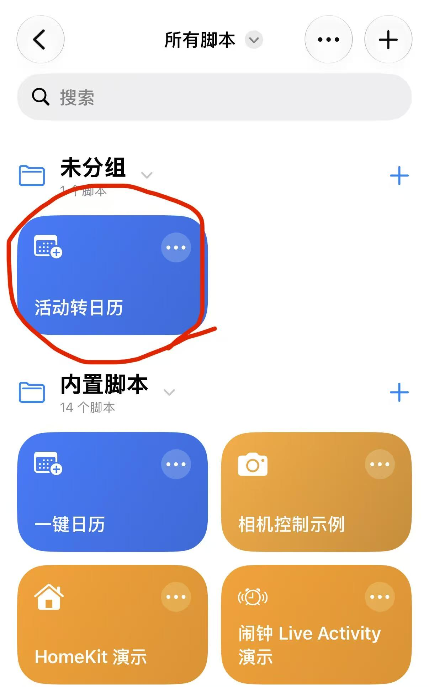
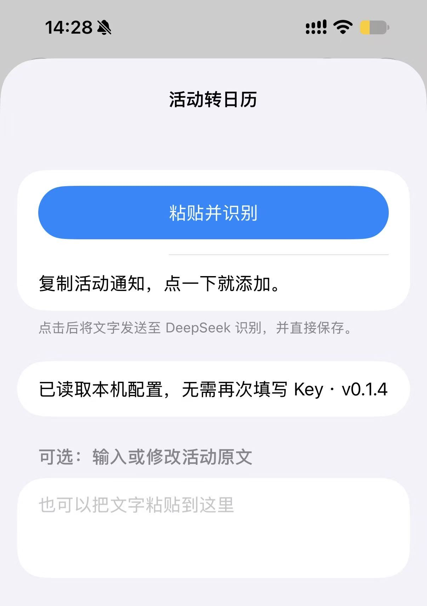
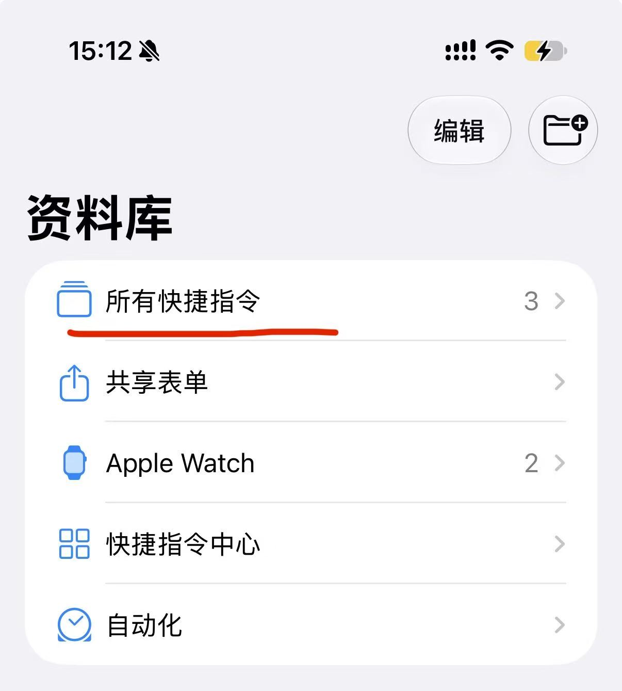
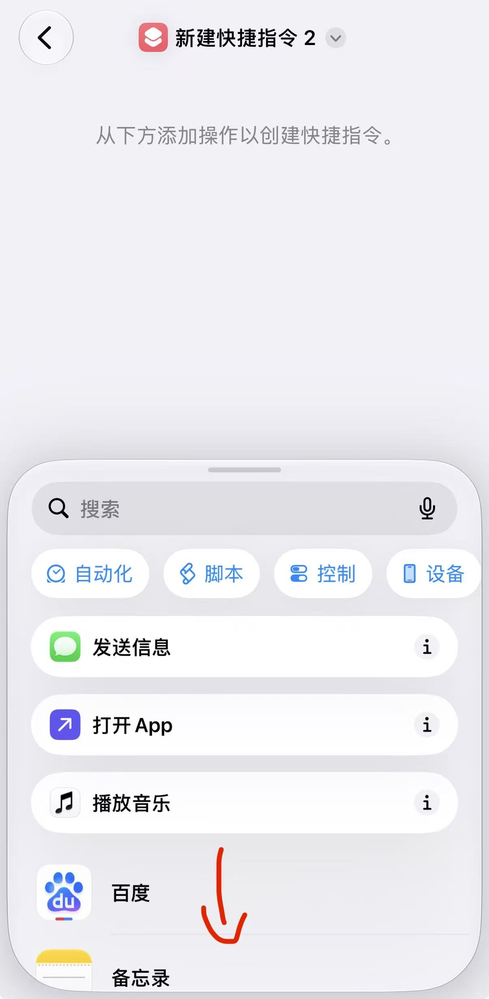
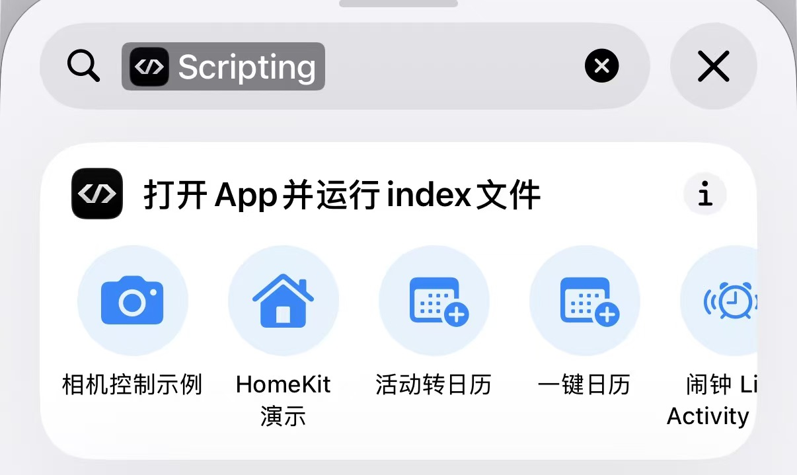
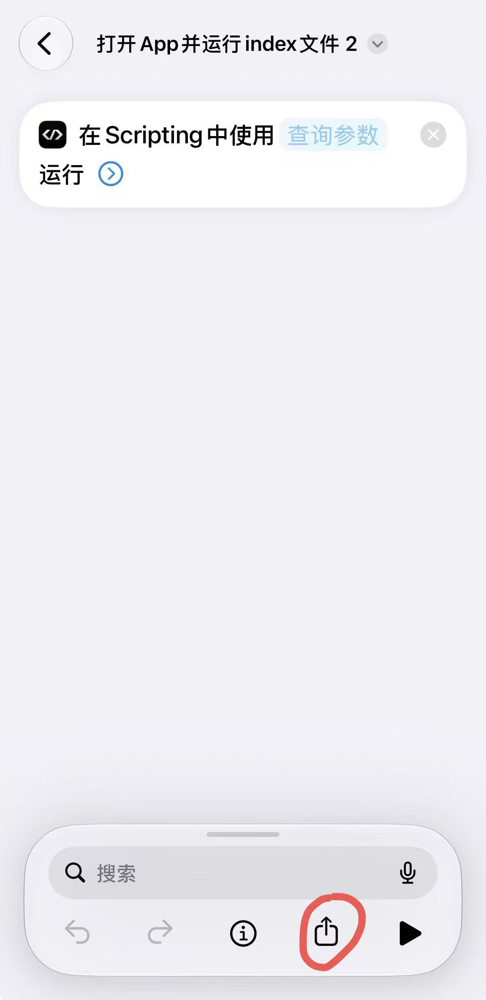
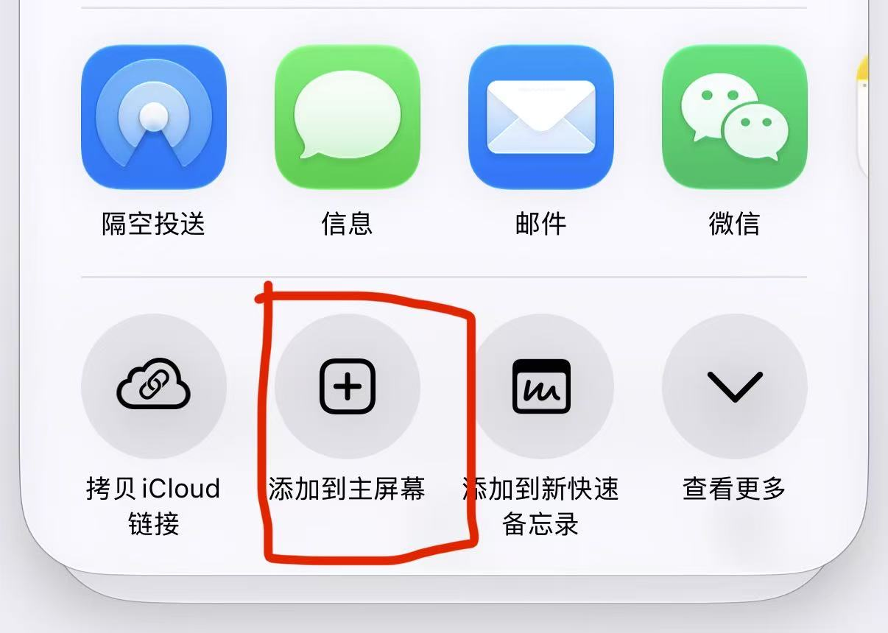
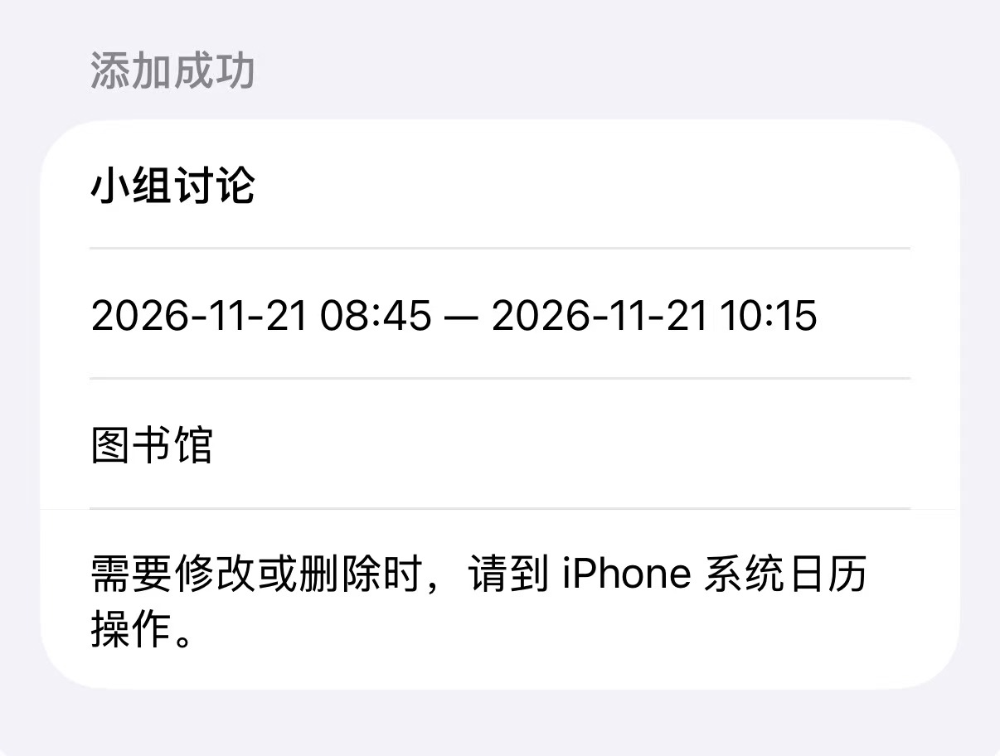

# 一键添加日历的脚本配置流程

配置时间稍长，可能总计需要 10-15 分钟，但是配置成功之后实现的效果是，只要复制活动信息，点击主屏幕的应用方式图标，点击粘贴，就可以自动识别并添加到系统日历。

因为我自己更习惯用手机端的日历，所以这整个流程也是适配**苹果手机端**。电脑上或许不需要这么麻烦？但因为我自己不是 macbook 所以我也没办法测试流程。🥲

我也会再摸索看看有没有更简便的方式。早用早享受！晚用说不定配置更简便。

**大致分成几步：**

在脚本里添加自己的 apikey → 将文件保存至手机文件 → 在 scripting 软件中导入脚本 → 在苹果快捷指令 app 中添加快捷指令

## 1. 脚本如下，需要发给 agent，并且把自己的 deepseek api key 发给它，让它补全文件中的 api key

[⬇️ 下载脚本文件 ActivityToCalendar-v0.1.4.scripting](./ActivityToCalendar-v0.1.4.scripting)

如果之前没有充值过 deepseek，可以在 [platform.deepseek.com/usage](https://platform.deepseek.com/usage) 网站上充值并且获得 api key。可以先充一块钱试试水，我感觉一块钱至少可以用一两个月。

## 2. 得到了含有自己 api key 的文件之后，将文件保存至手机文件

因为本人手机苹果电脑华为，所以选择了最古朴的方式，先把文件发给文件传输助手，然后点击"用其他应用打开"，再点击"保存到文件"。

## 3. 在 App Store 下载一个叫 Scripting 的软件

这个软件可以在手机上运行脚本。我们需要借助这个软件调用日历接口，才能实现自动化添加到系统日历的功能。

它长这样。

## 4. 打开 Scripting，点击右上角的三个点图标，选择"导入本地脚本"

然后，选择内置脚本或者未分组都无所谓，**点击右上角那个蓝色文件一样的小图标，选择我们刚刚保存到了本地的文件。**

**选择"我了解风险并导入"**。

这个时候会跳出来一长串代码，没关系不用管，点击左上角把它叉掉就可以，就回到了主界面，你会发现新增了一个叫做"活动转日历"的脚本。

**点击这个脚本，就会弹出来类似于这样的页面**

**当你看到这个页面的时候，我们就已经配置成功了！** 你只需要复制一段活动通知，打开 Scripting，点击这个脚本，点击"粘贴并识别"，相应活动信息就会自动添加到系统日历里。

但是但是但是，这个流程还是有些复杂。有没有什么办法可以直接打开脚本呢？这就需要用到苹果自带的快捷指令 App。

## 5. 打开苹果自带的快捷指令 App，在资料库页面点击"所有快捷指令"

**进入后点击下方"+"**。

在这个页面，沿着下方的 App 列表一直往下滑，直到找到 Scripting（S 开头的 App 应该在列表较靠后的位置）。

**找到 Scripting 之后点击进入，选择"打开 App 并运行 index 文件"，选择我们的脚本"活动转日历"。**

然后会进入到下面的这个页面，**点击下方的分享按钮，选择"添加到主屏幕"，选择自己喜欢的图标和颜色，这个快捷指令就添加到主屏幕啦。** 你也可以选择重命名，把"打开 App 并运行 index 文件"这个拗口的名字改掉。

## 最终效果

于是最终实现的功能是，只要复制活动信息，点击你添加到主屏幕的快捷方式图标，点击粘贴并识别，就可以自动识别并添加到系统日历。

比如说这样一段话：

> 哎那我们明天上午 8：45 这样图书馆可以吗～大概讨论个 1 个半小时这样，然后可以跟 @11 在线上同步一下，再分个工

你可以复制并粘贴，会得到

---

**完结撒花！**

---

## 源码

`src/` 里是脚本的源文件；根目录的 `.scripting` 文件就是这五个文件打包成的 zip。

| 文件 | 作用 |
| --- | --- |
| `index.tsx` | 界面和主流程 |
| `core.ts` | 提示词、日期解析、识别结果校验 |
| `runtime.ts` | 钥匙串、原生接口、错误脱敏 |
| `api-key.ts` | 本机 Key 配置（当前为空） |
| `script.json` | 脚本元信息 |

## 已知问题

- macOS 端流程尚未测试
- 每次使用需要手动点一次"粘贴并识别"
- 第 1 步需要改动源码再重新导入，是目前最麻烦的一环
